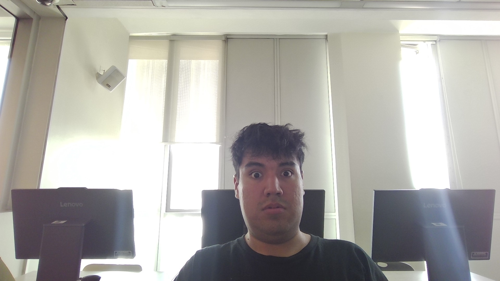

## arreglo de la arquitectura pq estaba al ñato

ahora el venv y el manage estan en root como dios manda.
falta dsps agregar lo de la evaluacion. 
### NO HACER LOS AVANCES DE LA EVALUACION AQUI PORFAVOR!!!!!!!!!!

 

mira hrmno me veo de la perra
<!--  -->
